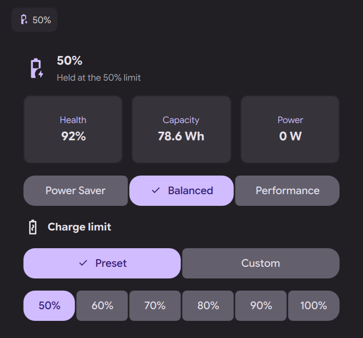

# dms-framework-battery



A battery widget for [Dank Material Shell](https://github.com/AvengeMedia/DankMaterialShell) that also sets the battery charge limit on Framework laptops, which the laptop's embedded controller (EC) enforces.

## Features
- Bar pill with the battery icon and percentage, optionally the time remaining and the power flowing in or out
- Popout with the charge state, health, capacity, power and power profile
- Charge limit presets (50–100% in steps of 10) and a custom value (20–100%)
- The popout always shows the limit the EC actually holds: it reads it when the widget loads and every time the popout opens
- While a limit applies, the time estimate runs to the limit, not to 100%, and the status says when the battery is held at the limit or being drained down to it

## Requirements
- DMS 1.7 or newer
- `ectool` with the Framework commands (Arch: `fw-ectool-git`, Dustin Howett's build)
- A polkit rule that lets `pkexec ectool` run without a password prompt: [`system/49-framework-ectool.rules`](system/49-framework-ectool.rules) goes in `/etc/polkit-1/rules.d/`

## Keeping the limit across reboots
The BIOS writes its own Setup charge limit into the EC on every boot and on every resume from hibernation, so a limit set from Linux is lost at the next one ([framework-system#25](https://github.com/FrameworkComputer/framework-system/issues/25)). The units in [`system/`](system/) save the EC's limit when the system shuts down or goes to sleep and put it back after boot and resume, whichever tool set it:

```bash
sudo install -m644 system/fw-charge-limit.service system/fw-charge-limit-sleep.service /etc/systemd/system/
sudo install -m644 system/90-fw-charge-limit.rules /etc/udev/rules.d/
sudo systemctl daemon-reload
sudo udevadm control --reload
sudo systemctl enable fw-charge-limit-sleep.service
sudo systemctl start fw-charge-limit.service
sudo systemctl restart fw-charge-limit.service   # records the current limit
```

The limit is kept in `/var/lib/fw-charge-limit/limit`. A limit changed after the last shutdown or sleep is lost if the machine crashes or loses power before the next one.

## Installation
```bash
cd ~/.config/DankMaterialShell/plugins
git clone https://github.com/Username2481632/dms-framework-battery dmsFrameworkBattery
dms plugins lock
```

Then add the widget to your Dank Bar in `Settings > Dank Bar > Widgets`, and change its settings in `Settings > Plugins > DMS Framework Battery`.

## Development
Reload the plugin after changing it with:
```bash
dms ipc call plugins reload dmsFrameworkBattery
```
